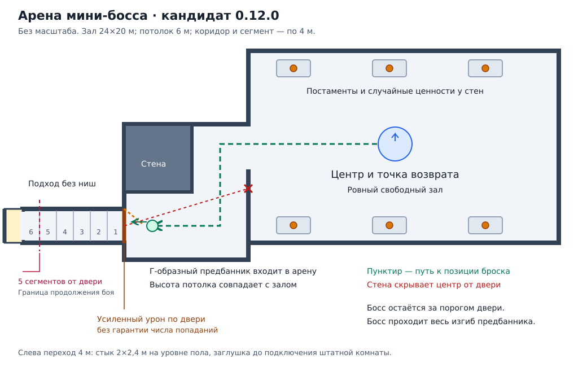

# Собственная арена мини-босса: уточнённая геометрия и поведение

Дата: 30 октября 2026 года, Asia/Yekaterinburg.
Статус: уточнённый план с принятыми решениями третьего сообщения пользователя.
Подготовлена схема; игровая арена и новый ИИ ещё не созданы. Активные поставка и мир не менялись.
Этот документ заменяет предложения о поведении из [первого разбора](2026-10-30-miniboss-arena-review.md).
Последнее уточнение отменяет гарантированное разрушение двери третьим попаданием и обязательную проверку
такого предела; фактическую возможность защищаться дверью пользователь проверяет сам.

## Подтверждённые решения

1. Собственная просторная арена с ровным полом, свободным центром и небольшими постаментами по краям.
   На постаментах случайные ценности по образцу прежнего помещения; они не мешают движению босса.
   Прежняя цель увеличения полезной площади примерно вдвое сохраняется как ориентир до обмера.
2. Г-образный предбанник закрывает прямой обзор центра и имеет такую же высоту потолка, как основной зал.
3. Попадание по боссу из-за двери немедленно включает выбор спец-атаки, без условия первого входа.
   Сохраняются согласованные подготовка, частота и обычный урон со свойствами босса.
4. При любом игроке на арене новую спец-атаку по игрокам начинать нельзя. Вход после начала подготовки
   не отменяет бросок. Во время применения босс защищён от прерывания атак; только смерть прерывает применение.
5. Снаряд без самонаведения сталкивается с дверью и другими физическими объектами, взрывается и наносит
   урон по площади. Радиус равен ширине коридора; дальность десять сегментов, скорость исходного броска ×1,5.
   По создаваемым преградам добавляется усиленный урон с типами `Chop`/`Pickaxe` при минимальном сопротивлении.
   Принудительного разрушения по счётчику попаданий нет; число попаданий для разрушения не гарантируется.
6. Пока есть хотя бы один участник боя в пределах пяти сегментов, на которого босс агрессивен, бой продолжается.
   После ухода всех участников за предел босс фиксирует возврат к центру, где восстанавливает полные HP и щит.
   Получаемые атаки и повторное приближение игрока не отменяют уже принятое решение вернуться.
7. Если путь возврата перекрыт постройками игроков, босс применяет к ним спец-атаку и продолжает возврат.
8. Дополнительный ответ: спец-атаки по мешающим постройкам **разрешены при игроках внутри** во время возврата.
9. Дополнительный ответ: при всех участниках дальше пяти сегментов **возврат и лечение имеют приоритет**;
   дальние попадания не удерживают бой и не вызывают дополнительного ответного броска перед возвратом.
10. Предбанник входит в арену, босс проходит весь изгиб; пять сегментов считаются по маршруту от порога двери.
    Тактика «танк внутри, стрелок снаружи» прямо разрешена.
11. Постоянные стены, включая Г-образный предбанник, экранируют взрыв. Дверь и постройки не дают такой защиты
    персонажу в радиусе взрыва. Постоянную геометрию арены усиленная атака не разрушает.
12. При технической возможности реализовать временный запрет новой стройки на узком пути возврата
    и мягкое расталкивание блокирующих игроков. Полные HP и щит восстанавливать однократно при прибытии;
    ценности не пополнять.

HP ×12, урон ×3, масштаб ×1,8, исходные помощники 85%/15% и награда за смерть сохраняются.
Иммунитет к прерыванию не означает бессмертие: убитый босс не доходит до центра и не восстанавливается.
Предыдущее требование разворачиваться в центре спиной ко входу сохраняется.

## Согласованное размещение

Схема без масштаба; число постаментов условное. Это проект размещения, а не подтверждённая игровая геометрия.
Прямой участок из шести сегментов располагается со стороны данжа перед дверью; Г-образный предбанник — за ней.
Так оба требования совместимы. Предбанник считается частью арены, как и остальное пространство за дверью.
Прямого луча от двери к точке покоя босса нет. Для броска в коридор босс занимает доступную позицию внутри
предбанника, оставаясь за порогом. Он должен проходить весь изгиб: недоступный ему угол создаст новое укрытие.

Ровный пол, высота потолка и свободный маршрут проверяются по увеличенному коллайдеру и навигации обоих видов.
Постаменты стоят вне полосы перемещения и точки возврата. Они не должны создавать платформу, с которой можно
безнаказанно атаковать босса, неспособного достать игрока. Основные стены, пол и потолок — постоянная геометрия,
которую усиленный урон преградам не разрушает. Дверь и постройки игроков имеют отдельную классификацию.

Точка отсчёта пяти сегментов — внешний порог двери; расстояние измеряется по маршруту,
не по прямой через стены и не от движущегося босса. Сохранять границу отдельно от объекта разрушаемой двери.
Внутренние игроки находятся в зоне боя. Длины конкретных сегментов и десятисегментную дальность переводить
в метры по выбранной геометрии; значение в метрах пока не назначено. Ровно пять входит в зону продолжения.
Дальность десять — предел полёта, а не новый радиус агрессии: уже выпущенный снаряд может долететь дальше пяти.

Ценности выбираются один раз при генерации и сохраняются вместе с подбором. Возврат, лечение, перезапуск
и повторный вход не пополняют постаменты. Это обычная добыча склепа, отдельно от награды за смерть босса;
ресурсы ×3 применяются в обычном механизме один раз. Число, состав и итоговые количества ещё не измерены.
Текущий `MiniBossTrial.ClearNative` удаляет штатные `Pickable`, поэтому новое наполнение нужно создавать отдельно.

## Приоритеты состояний

Состояние и текущую атаку изменяет один сетевой владелец. Решение возврата, стадия броска и факт лечения
должны переживать передачу владения; дублирование урона двумя владельцами недопустимо.

| Состояние/условие | Действие |
| --- | --- |
| Босс погиб | Прервать подготовку, исключить лечение и новые броски; награда по прежнему правилу |
| Спец-атака уже начата | Завершить её, даже если игрок вошёл или все ушли за предел |
| Во время подготовки принято решение возврата | Запомнить решение; начать возврат сразу после завершения броска |
| Возврат уже начат | Двигаться в центр; вход и атаки игроков не переключают на преследование |
| Возврат перекрыт постройкой | Спец-атака по преграде, затем продолжение возврата; игроки внутри не запрещают её |
| Возврат завершён живым боссом | Однократно восстановить HP и щит, развернуться спиной ко входу |
| Есть активный участник в пределах пяти, на арене кто-либо есть | Обычный бой, без новых спец-атак по игрокам |
| Есть активный участник в пределах пяти, арена пуста | Выбор спец-атаки против внешней цели |
| Все активные участники за пределом пяти | Зафиксировать возврат; новые дальние попадания не отменяют его |

Таблица уточняет порядок выполнения совместимых требований. Смерть имеет наивысший приоритет;
уже начатый бросок не отменяется переходом к возврату, поскольку пользователь запретил такое прерывание.
«Немедленно» относится к выбору режима, а не к нулевому замаху или обходу паузы между атаками.
Полные здоровье и щит восстанавливать событием прибытия, а не каждый кадр нахождения в центре.
Повторный бой после завершения возврата снова подчиняется зоне пяти сегментов и присутствию игроков внутри.

Для смены условий учитывать всех участников, на которых босс агрессивен, а не только одну текущую цель ИИ.
Игрок на арене запрещает выбор новой атакующей спец-атаки, даже если сам не атакует.
Тактика «танк внутри, стрелок снаружи» отдельно подтверждена пользователем и не считается запрещённым обходом.

## Технические условия и оставшиеся риски

Разбор ниже отделяет подтверждённые правила от ещё не проверенных в игре способов их реализации.

- **Лечение и щит.** У `Warded` часть исходного запаса находится в отдельном щите PoV. Полный HP не означает
  полный щит; пользователь подтвердил восстановление обоих. Заполнять существующие запасы до их максимумов,
  сохраняя сетевое состояние щита. Не применять повторное разделение `RuneWard.Give` и множитель HP ×12.
  Оставшиеся периодические эффекты могут нанести урон после лечения; не очищать их молча и не лечить бесконечно.
- **Урон преградам.** `Chop` и `Pickaxe` в `HitData` — отдельные типы урона. `ApplyResistance` обрабатывает
  их сопротивления, а `WearNTear` и `Destructible` отдельно проверяют уровень инструмента. Эти поля не означают
  универсальное пробивание. Для разрушаемых преград закреплённого набора требуется совместимый уровень
  инструмента и отдельный расчёт эффективного урона с учётом материала. Если нужны адаптеры сопротивлений,
  ограничивать их этим спец-ударом и конкретной преградой; обычные prefab и атаки глобально не менять.
  Усиление не попадает в урон персонажам; объект получает один удар взрыва независимо от числа коллайдеров.
  Постоянная геометрия не относится к разрушаемым преградам. Проверка ненулевого урона и сохранности геометрии
  остаётся необходимой, но обязательного числа попаданий, счётчика и принудительного разрушения больше нет.
- **Ремонт.** В сохранённом нативном каталоге `dungeon_forestcrypt_door` есть `WearNTear`, но нет `Piece`.
  `Player.Repair` требует наведённый `Piece` и только затем вызывает `WearNTear.Repair`; текущая дверь
  не является обычной ремонтируемой постройкой. Прежнее предположение о её ремонте было излишним.
  Для других построек требование станции зависит от `Piece` и настроек мира; отсутствие верстака не является
  универсальным доказательством запрета ремонта всех объектов. Особые меры против ремонта сейчас не добавляются.
- **Защита закрытой двери.** `ForestGates.Damage` блокирует урон от NPC до первого открытия.
  Нужна узкая проверка разрешённого спец-удара босса по преграде его встречи; общий запрет для прочих NPC
  и обычных дверей не снимать. Открытие/удаление двери не должно удалять границу арены или выключать ИИ.
- **Взрыв за преградой.** Столкновение обязательно вызывает один взрыв. Попадание в дверь и воздействие
  на стоящего за ней игрока — разные проверки. Постоянные стены экранируют, дверь и постройки такой защиты
  в радиусе не дают. Для лучей проверки укрытия использовать явные признаки постоянной геометрии арены,
  не только название или материал: каменная постройка игрока не становится постоянной стеной.
  В точке контакта с преградой корректно выбирать начало луча, чтобы взрыв не оказался за стеной из-за смещения.
- **Бесконечное блокирование возврата.** Игроки могут постоянно ставить новые стены или перекрывать путь телами.
  Одобрены временный запрет новой стройки на узком пути возврата и мягкое расталкивание; техническая корректность
  ещё не подтверждена. Стройку отклонять до расхода ресурсов, с понятным сообщением, согласованно между клиентами.
  Это дополнительное временное ограничение не разрешает строительство там, где оно уже запрещено игрой.
  Снимать ограничение при прибытии, смерти и удалении встречи; после загрузки сверять его с состоянием возврата.
  Расталкивание применять лишь к реально мешающему игроку, без урона и перемещения сквозь стены или за край пола.
  При отсутствии безопасного направления фиксировать застревание; телепортация и бессмертие не согласованы.
- **Иммунитет к прерыванию.** Недостаточно отключить одну анимацию оглушения: проверить отталкивание, парирование,
  заморозку и модовые эффекты, способные остановить применение. Сохранять обычный входящий урон.
  Снятие защиты после завершения или смерти обязательно; защита не переносится на весь бой.
- **Потеря цели во время броска.** Выход или смерть игрока не являются разрешённой причиной отмены применения.
  Предлагается бросать в последнюю известную точку, если цели больше нет, без получения скрытых координат.
  Смерть босса до выпуска отменяет бросок; уже выпущенный снаряд предлагается сохранять как физический объект.
- **Урон при возврате.** Босс остаётся убиваемым до лечения, поэтому его можно добить во время отхода.
  Удары не возвращают его к преследованию. Спец-атака по преграде может задеть игрока внутри арены взрывом;
  это следствие разрешённого исключения, хотя сам игрок не выбран целью.

## Проверки следующего кандидата

Сначала на отдельном профиле проверить собственный зал: полезную площадь, навигацию ×1,8, изгиб,
постаменты, отсутствие укрытий от недоступного босса, стену обзора, высоту потолка и попадания в дверь.
Затем отдельно проверить снаряд и только после этого подключать полный набор свойств и поведение встречи.

Необходимые сценарии:

- Внешний выстрел без первого входа; выбор броска с подготовкой и без лишнего умножения урона.
- Игрок внутри до подготовки; вход после её начала; смерть босса до и после выпуска.
- Смена целей между двумя клиентами; один остаётся внутри/в зоне пяти, остальные отступают.
- Все уходят за пять, но продолжают стрелять; повторный вход во время возврата не отменяет решение.
- Преграда на возврате при игроке внутри; отдельный урон по материалам без прибавки урона игроку.
- Столкновение с дверью/стеной/постройкой, единичный взрыв, поражение за преградой согласно выбранному правилу.
- Блокирование пути постройками и телами, отсутствие движения, смерть до прибытия, однократное лечение в центре.
- Запрет стройки только на время возврата и только на его пути; отказ без потери ресурсов и снятие ограничения.
- Расталкивание возле угла, двери и постамента: без проникновения в стены и выброса за пределы пола.
- Восстановление HP и щита без повторного изменения максимумов; оставшиеся периодические эффекты.
- Повторный бой, сохранение, перезапуск и передача владельца: без повторного броска, лечения или ценностей.

Проверенные размеры, параметры снаряда и прохождение урона фиксируются после нативной пробы.
Обязательная проверка разрушения третьей атакой отменена; оценку защиты дверью выполняет пользователь.
Схема и анализ кода не заменяют игровую проверку; полный серверный выпуск по этому документу не выполнялся.

## Основания разбора

Прочитаны актуальное состояние и runbook, код `MiniBossRuntime`, `MiniBossTrial`, `ForestGates`,
`ForestRuntime`, `ForestPlan` и правила проекта. Проверены ранее извлечённые `Destructible`, `WearNTear`,
`Character` и `MonsterAI` закреплённой игры: сопротивления, требования к инструменту, оглушение и отталкивание.
При последнем уточнении также прочитаны `HitData`, `Player`, `RuneWard` и сохранённый каталог двери.
Проверены типы урона, сопротивления, уровень инструмента, штатный путь ремонта и размещения построек,
а также отдельное сохранение щита. Новые исполняемые игровые проверки не запускались.
Локальные исходные материалы остаются в `.local/`; публичны только выводы и собственная схема.
